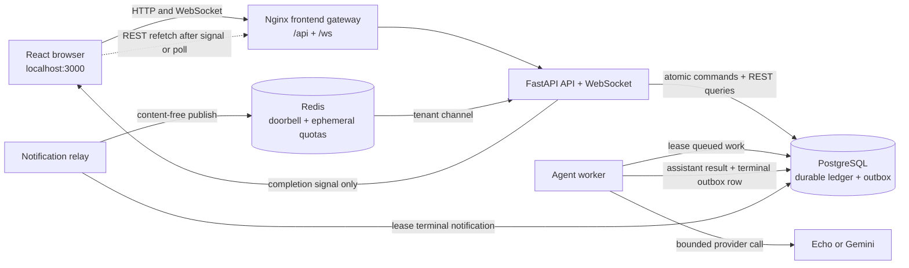

# Enterprise Chat Platform

A production-oriented, multi-tenant chat system built with Python 3.12,
FastAPI, PostgreSQL, Redis, React, and an asynchronous AI worker. The project
shows how to accept a message quickly, process it safely in the background,
notify the browser in real time, and still recover when a process or network
connection fails.

This is the completed Day 8 learning project. It includes a browser dashboard,
a local JWT demo login, durable asynchronous processing, WebSocket
notifications, REST recovery, and an optional Gemini provider.

## What is included

- Python 3.12 project managed and locked with uv
- React dashboard served through an Nginx frontend gateway on
  <http://localhost:3000>
- FastAPI commands, queries, health checks, JWT authentication, and WebSockets
- Tenant-scoped conversations, immutable messages, and agent-run lifecycle
- Idempotent conversation creation and user-turn acceptance
- PostgreSQL transactions, optimistic concurrency, and a transactional outbox
- Recoverable worker with leases, fencing, timeouts, retry, and backoff
- Durable terminal notifications relayed to Redis by `enterprise-chat-relay`
- Redis Pub/Sub, connection presence, and disposable quota counters
- WebSocket completion signals followed by authoritative REST refetches
- Deterministic local Echo provider and optional Gemini REST adapter
- Alembic migrations and separate bootstrap, migrator, and runtime DB roles
- Unit, frontend, contract, concurrency, migration, and PostgreSQL tests

## Architecture in plain language

Think of the system as a restaurant with a reliable paper trail:

- The **frontend gateway** is the reception desk. The browser uses one origin,
  and Nginx sends `/api` and `/ws` traffic to FastAPI.
- The **API** is the waiter. It checks identity, validates the order, and
  returns quickly.
- **PostgreSQL** is the official order ledger. Conversation history, queued
  work, idempotency receipts, and notification records live there.
- The **outbox** is a mailbox inside that same ledger. Writing the chat change
  and its work ticket in one transaction prevents the classic “saved the
  message but forgot to queue the job” failure.
- The **worker** is the cook. It leases a queued ticket, calls Echo or Gemini
  outside the database transaction, then records the final result.
- The **relay** is the mail carrier. It leases the durable terminal-notification
  row and rings Redis after the run finishes.
- **Redis** is a doorbell, not the ledger. A missed ring never deletes the
  result because the result remains in PostgreSQL.
- The **WebSocket** tells the browser that something changed. It deliberately
  carries no prompt or assistant content.
- The browser then **refetches through REST** and renders the authoritative
  PostgreSQL state. It also polls while a run is pending, so a lost WebSocket
  signal does not strand the UI.



The full component and event-flow explanation is in
[docs/architecture/full-stack.md](docs/architecture/full-stack.md). The core
business invariants are in
[docs/architecture/chat-domain.md](docs/architecture/chat-domain.md).

## One message from start to finish

1. The browser creates a conversation and sends a message with a new
   `Idempotency-Key`.
2. The API commits the user message, queued run, idempotency receipt,
   conversation version, and worker outbox row in one PostgreSQL transaction.
3. The API returns `202`; it does not wait for the model.
4. The worker leases the outbox row with `FOR UPDATE SKIP LOCKED`, commits the
   short claim, and calls the configured provider without holding a DB
   transaction open.
5. On success, one transaction appends the assistant message, completes the
   run, and creates a durable `agent_run.terminal.v1` notification row.
6. The relay leases that notification and publishes a content-free event to a
   tenant-specific Redis channel.
7. The API's Redis subscriber forwards the signal only to authenticated local
   WebSocket clients subscribed to that conversation.
8. The browser receives the signal and fetches the run and messages through
   REST. PostgreSQL—not the WebSocket payload—supplies the displayed content.

Duplicate provider calls or duplicate Redis signals are possible around
crashes because both boundaries are at-least-once. Leases, fencing,
idempotency, event IDs, and idempotent REST reads make those duplicates safe.

## Requirements

- [uv](https://docs.astral.sh/uv/)
- Python `>=3.12,<3.13`
- Docker with Docker Compose
- Git
- OpenSSL for local secret generation
- Node.js 20 only when running frontend checks directly on the host

Confirm the Python interpreter:

```bash
uv run python --version
```

It must report Python `3.12.x`.

## Local Docker workflow

Enter the project and run the safe local helper:

```bash
cd day8-enterprise_chat_agent
./scripts/start-local.sh
```

On the first run, the helper copies `.env.example` to a mode-`600` `.env`,
generates separate URL-safe PostgreSQL passwords and a local JWT demo secret
without printing them, validates the Compose configuration, builds the images,
and waits for the stack to become healthy. It preserves existing nonblank
values. These are development credentials; never commit `.env`.

The local full-stack profile uses:

```dotenv
CHAT_AUTH_MODE=jwt
CHAT_DEMO_AUTH_ENABLED=true
CHAT_JWT_ALGORITHM=HS256
CHAT_JWT_KEY=replace-with-a-long-random-local-secret
CHAT_REALTIME_ENABLED=true
CHAT_PROVIDER_MODE=echo
```

The expected services are:

| Service | Expected state | Job |
|---|---|---|
| `postgres` | healthy | Durable data, idempotency, and outbox ledger |
| `redis` | healthy | Ephemeral Pub/Sub, presence, and quotas |
| `migrate` | exited `0` | One-shot `alembic upgrade head` |
| `api` | healthy | REST, JWT validation, and WebSockets |
| `worker` | running | Provider work and durable result commits |
| `relay` | running | PostgreSQL terminal outbox to Redis Pub/Sub |
| `frontend` | healthy/running | React assets and same-origin gateway |

Open <http://localhost:3000>. Choose Acme Corp or TechStart Inc and a demo
role, sign in, and send a message. The default Echo provider returns a
deterministic response without external network access.

Check health through the browser gateway. The Compose API has no host port; it
is reachable only through this same-origin gateway:

```bash
curl --fail-with-body http://localhost:3000/api/health/live
curl --fail-with-body http://localhost:3000/api/health/ready
```

Follow the asynchronous path in the logs:

```bash
docker compose logs --follow --tail=100 api worker relay
```

Stop stateless services while preserving PostgreSQL data:

```bash
./scripts/stop-local.sh
```

See [docs/operations.md](docs/operations.md) for restart, inspection, recovery,
and local reset procedures.

## Demo login is not production SSO

The bundled `/auth/login` route exists only to make the local dashboard easy
to explore. When explicitly enabled in `local` or `test`, it converts an
allowlisted demo tenant and role into a short-lived HS256 JWT. It is not a
password system, SSO implementation, or production identity provider.

Staging and production fail configuration validation if demo login is enabled.
A real deployment must:

- use an external OIDC/SAML-backed identity provider;
- let that provider authenticate users and issue JWT access tokens;
- configure this API with pinned `RS256` or `ES256` verification settings;
- include `exp`, `iat`, `iss`, `aud`, `sub`, and `tenant_id` claims;
- treat `sub` and `tenant_id` as UUIDs and derive identity only from the
  verified token; and
- use TLS/WSS and an intentional browser token-handling strategy.

Development header authentication remains useful for focused API tests, but it
is a separate mode and is forbidden in staging and production.

## Optional Gemini provider

Echo is the safe local default. To exercise the external provider boundary,
set the worker to Gemini and inject the API key through local secrets:

```dotenv
CHAT_PROVIDER_MODE=gemini
CHAT_GEMINI_API_KEY=replace-locally
CHAT_GEMINI_MODEL=gemini-2.5-flash
```

Then recreate the worker:

```bash
docker compose up --build --detach worker
```

The Gemini adapter uses a bounded HTTP call, classifies timeouts, `408`, `429`,
and `5xx` responses as transient, and returns only safe failure messages to the
client. It never makes Redis or Gemini authoritative for chat history. External
model usage can incur cost; keep Echo enabled when learning the architecture.

## Reliability and failure behavior

| Failure | What the system does | User-visible result |
|---|---|---|
| API response is lost after commit | Exact retry with the same idempotency key returns the original IDs | No duplicate user turn |
| Worker stops | Queued work stays in PostgreSQL; an expired lease can be reclaimed | Run remains pending until a worker returns |
| Provider is temporarily unavailable | Worker releases the lease and retries with bounded backoff | UI waits and polls |
| Provider exhausts attempts | Run becomes failed with a safe public message | Browser refetch shows terminal failure |
| Relay or Redis stops | Terminal notification remains pending in PostgreSQL | WebSocket signal is delayed; REST polling still finds the result |
| Relay publishes, then crashes before marking | The event may be published again after lease expiry | Duplicate signal causes another safe REST refetch |
| WebSocket disconnects | Browser reconnects with bounded backoff and continues polling | Chat remains usable through REST |
| Frontend gateway stops | Browser entry point is unavailable | Durable work and data remain intact |
| PostgreSQL stops | Readiness returns `503`; durable commands cannot safely proceed | No false successful write |

The WebSocket event contains IDs, terminal status, conversation version, and
message sequence only. It does not contain prompts or assistant content.

## Authentication and health

- `GET /health/live` proves that the HTTP process is alive.
- `GET /health/ready` checks PostgreSQL and, when realtime is enabled, Redis.
  A required dependency failure returns `503` so traffic can be removed.
- JWT algorithms, issuer, and audience are pinned by configuration.
- WebSockets authenticate in the first frame, enforce an origin allowlist,
  authorize each conversation subscription, limit frame size, and maintain
  expiring connection leases.

## Test commands

Run the locked Python quality gates:

```bash
uv lock --check
uv sync --frozen --all-groups
uv run ruff format --check src tests migrations
uv run ruff check src tests migrations
uv run mypy src tests migrations/env.py migrations/versions
uv run pytest -q
```

Run frontend checks:

```bash
npm --prefix frontend ci
CI=true npm --prefix frontend test -- --watchAll=false --runInBand
npm --prefix frontend run build
```

Run real PostgreSQL integration tests after the local database is healthy and
migrated. First export the two host database URLs as described in the
[migration workflow](docs/operations.md#migration-workflow), then run:

```bash
docker compose up --detach postgres
uv run alembic upgrade head
uv run pytest -m integration -q
uv run alembic check
```

`alembic check` must report `No new upgrade operations detected.` Integration
tests must point only at the disposable local Compose database.

## Project structure

```text
.
├── compose.yaml                  # full local service graph
├── Dockerfile                    # non-root Python 3.12 runtime image
├── docker/
│   ├── Dockerfile.frontend       # React build + Nginx runtime
│   ├── nginx.conf                # same-origin /api and /ws gateway
│   └── postgres/init/            # one-time roles, DB, and schema bootstrap
├── frontend/                     # React dashboard and browser tests
├── migrations/                   # ordered Alembic schema changes
├── scripts/
│   ├── start-local.sh            # generate local secrets, build, and wait
│   └── stop-local.sh             # safe stop; optional destructive reset
├── docs/
│   ├── architecture/full-stack.md
│   ├── architecture/chat-domain.md
│   └── operations.md
├── src/enterprise_chat_platform/
│   ├── api/                      # auth, commands, queries, health, WebSocket
│   ├── application/              # use cases and transport-independent ports
│   ├── domain/                   # framework-independent business rules
│   ├── infrastructure/
│   │   ├── persistence/          # models, UoWs, repositories, leased stores
│   │   ├── realtime/             # Redis publisher/subscriber and connections
│   │   ├── chat_provider.py      # local Echo adapter
│   │   └── gemini_provider.py    # optional Gemini REST adapter
│   ├── main.py                   # API composition
│   ├── worker.py                 # `enterprise-chat-worker`
│   └── relay.py                  # `enterprise-chat-relay`
└── tests/
    ├── api/
    ├── unit/
    └── integration/              # real local PostgreSQL tests
```

Dependencies point inward: transport and infrastructure depend on application
and domain contracts; the domain does not import FastAPI, Redis, or SQLAlchemy.

## Production checklist

- Disable demo login and development-header authentication.
- Integrate an external IdP; use asymmetric JWT verification and TLS/WSS.
- Put signing/verification material, DB passwords, Redis credentials, and the
  Gemini key in a secret manager; never bake them into images.
- Use managed PostgreSQL backups, point-in-time recovery, restore drills, and
  a migration approval pipeline.
- Use authenticated/TLS Redis, memory limits, and a topology appropriate for
  disposable Pub/Sub and counters—not durable chat storage.
- Keep API/worker/relay DB credentials DML-only and migrator credentials only
  in the migration job.
- Set an explicit WebSocket origin allowlist; never use `*` in deployment.
- Scale API, workers, and relays independently; test lease, quota, and provider
  limits at expected peak concurrency.
- Alert on readiness, outbox age/depth, retries, terminal failures, Redis
  disconnects, WebSocket counts, provider latency, and error rate.
- Keep prompts, message content, bearer tokens, API keys, and raw provider
  errors out of logs and Redis notifications.
- Add PostgreSQL row-level security if hostile tenants share a database; the
  current application and composite constraints enforce tenant scope, but RLS
  is an additional defense.
- Verify the provider's data retention, regional, safety, rate-limit, and
  idempotency behavior before sending production data.
- Load-test the gateway and WebSocket upgrade path, rehearse worker/relay
  crashes, and document rollback and incident ownership.

RAG, embeddings, tool execution, billing, and token streaming are separate
bounded contexts and are intentionally not hidden inside this reliable core.

## License

No license has been selected yet.
