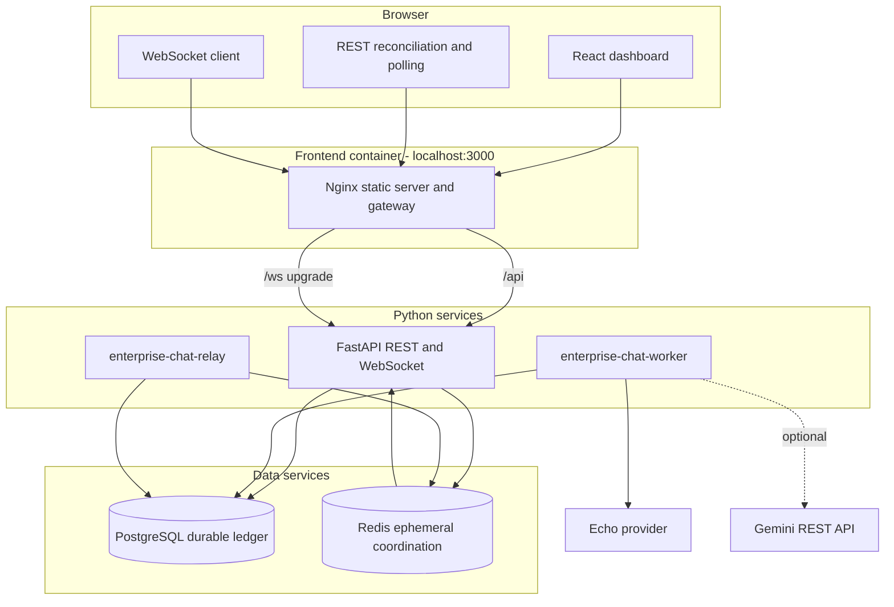
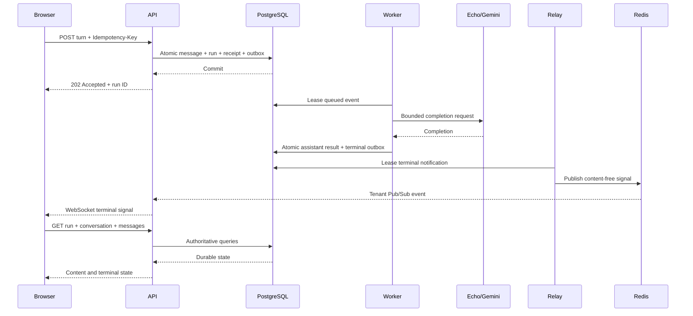

# Full-stack architecture

Status: Implemented
Audience: learners, developers, reviewers, and operators

## The central reliability rule

PostgreSQL is the only durable source of truth.

Redis and WebSockets make the interface feel immediate, but neither owns chat
history or pending work. If Redis is restarted, a socket disconnects, or the
browser is closed, the conversation, run, and terminal notification still
exist in PostgreSQL and can be recovered through REST.

A useful real-world comparison is a parcel delivery:

- PostgreSQL is the warehouse inventory system.
- An outbox row is a shipping label stored with the parcel record.
- The worker prepares the parcel.
- The relay asks the courier to ring the customer's doorbell.
- Redis and the WebSocket are the doorbell.
- REST is the customer checking the official tracking page.

The doorbell is convenient. The tracking record is authoritative.

## Components and ownership

| Component | Owns | Must not own |
|---|---|---|
| React browser | Temporary UI state, optimistic rendering, reconnect/poll timers | Trusted identity, durable messages, final run state |
| Nginx frontend gateway | Static assets and same-origin `/api` + `/ws` routing | Authentication decisions or business state |
| FastAPI API | HTTP/WebSocket policy, validation, authentication, use-case composition | Provider work or durable in-process queues |
| PostgreSQL | Conversations, messages, runs, idempotency receipts, outbox rows | Live socket objects |
| Agent worker | One leased provider attempt at a time | Browser connections or long-lived DB transactions |
| Echo/Gemini provider | Producing one bounded text completion | Conversation authority or tenant authorization |
| Notification relay | Moving durable terminal rows to Redis with leases and retry | Chat content |
| Redis | Pub/Sub signals, expiring connection presence, disposable quotas | Conversation history or the only copy of pending work |
| API WebSocket process | Authenticated local socket registry and subscriptions | Durable delivery history |

## Component diagram

The frontend gateway gives the browser one origin. This avoids teaching the
browser separate API and WebSocket hosts locally and gives production a clear
place for TLS termination, request limits, and upgrade forwarding.

## Durable command path

When a user submits `"Explain the outbox pattern"`, the browser creates an
idempotency key such as `turn-<uuid>`. The API does not call the model. It uses
one transaction to write:

1. the immutable user message;
2. a queued agent run;
3. the idempotency receipt containing the original result IDs;
4. the conversation's next sequence/version using optimistic concurrency; and
5. a queued outbox event for the worker.

All five commit, or none commit. This closes two common failure windows:

- A message cannot commit without its background job.
- A retry after an uncertain HTTP response can return the original result
  instead of creating a second message.

The idempotency scope is tenant + conversation + operation + key. Replaying
the same scope and request returns the original result. Reusing the key for a
different request returns a conflict.

## Worker path

The worker follows a claim, call, complete pattern:

1. Claim one due queued event using `FOR UPDATE SKIP LOCKED`.
2. Increment its attempt count and store a unique lease token and expiry.
3. Move the run to `running` and commit that short transaction.
4. Call Echo or Gemini with a timeout while no DB transaction is open.
5. Open a new transaction and use the lease token as a fence.
6. On success, append the assistant message, advance the conversation, mark
   the run succeeded, publish the original worker event, and insert a pending
   terminal-notification outbox row.
7. On a transient failure, clear the lease and delay the event with bounded
   exponential backoff.
8. On a terminal failure or exhausted attempt budget, fail the run with a safe
   message and insert the terminal-notification row.

If worker A pauses after its lease expires and worker B reclaims the row,
worker A's old token cannot overwrite worker B's result. That is lease fencing.

The provider boundary is at-least-once. A crash after the provider accepted a
request but before PostgreSQL recorded the result can cause another provider
call. Production adapters should send the agent-run ID as the provider's
idempotency key when the provider supports one.

## Notification path: durable mailbox to disposable doorbell

The terminal row uses event type `agent_run.terminal.v1`. Its payload contains
only:

- `agent_run_id`
- `status`
- nullable `output_message_id`
- `conversation_version`
- nullable `message_sequence`

It contains no prompt, user content, or assistant content.

`enterprise-chat-relay` claims one pending terminal row from PostgreSQL using
`FOR UPDATE SKIP LOCKED`, increments its attempt counter, and sets a unique
lease token. It publishes the validated event to a tenant-specific Redis
channel and then marks the row published using that token.

If Redis publication fails, the relay reschedules the row with bounded
backoff. If it publishes and crashes before marking the row, the lease later
expires and the same event can be published again. This is intentional
at-least-once delivery. The event ID lets consumers ignore a duplicate, and a
second REST refetch is safe even when they do not.

## WebSocket notification plus REST refetch

The WebSocket is notification-only:

1. The browser opens `/ws/{client_connection_id}` through the gateway.
2. Its first frame carries the JWT; query-string tokens are not used.
3. The API validates the token, tenant, origin, frame size, and connection
   quota.
4. The browser subscribes to a conversation.
5. The API checks that the authenticated actor may read that conversation.
6. A terminal Redis signal is sent only to matching, authenticated local
   subscribers.
7. The browser receives IDs/status and refetches the run, conversation, and
   messages using authenticated REST.

The browser also polls while its run is pending. When the WebSocket is healthy,
polling is slower because the signal should arrive first. When disconnected,
polling becomes faster. This combines good latency with reliable recovery.

## Authentication boundary

### Local demo

The demo login is explicitly gated to `local` and `test`. It resolves one of
the allowlisted demo tenants, creates a stable demo user for the chosen role,
and signs a short-lived HS256 JWT. This gives the browser a real bearer-token
flow without pretending to be a real identity system.

The demo route must not be exposed as production SSO. It has no password,
federation, MFA, lifecycle management, or account recovery.

### Production identity provider

In staging and production, settings validation requires JWT mode, forbids demo
login and insecure development headers, and rejects HS256. A real IdP should
authenticate the user and issue an RS256/ES256 access token. The API validates
the pinned algorithm, signature, issuer, audience, expiry, issued-at time,
subject, and tenant claim before constructing the trusted actor context.

For a browser deployment, use an appropriate OIDC flow such as Authorization
Code with PKCE and make an explicit decision about token storage/refresh. The
bundled local dashboard stores its demo token in browser storage for learning;
that is not a complete production session design.

## Provider modes

| Mode | Use | Network behavior |
|---|---|---|
| `disabled` | Fail-closed deployments where no provider is approved | Worker refuses to start processing |
| `echo` | Local learning and deterministic tests | No external model I/O |
| `gemini` | Optional real completion adapter | HTTPS request to configured Gemini endpoint |

The Gemini adapter sends only the current input content required for this
project, bounds the call with a timeout, truncates accepted text to the domain
limit, and maps transport/HTTP failures to safe transient or terminal errors.
Only the worker uses the provider credential. A production deployment should
also inject that secret into the worker alone rather than sharing one runtime
environment block across services.

## Scaling model

- Multiple API replicas can serve REST and WebSockets. Redis Pub/Sub delivers
  each tenant signal to each subscribed API process, and each process fans out
  only to its own authorized sockets.
- Multiple workers safely compete for queued rows through `SKIP LOCKED` and
  lease fencing.
- Multiple relays safely compete for terminal rows through the same pattern.
- PostgreSQL remains the concurrency boundary; scale and tune it for the
  durable workload.
- Redis data is expiring or Pub/Sub-only, so losing it affects immediacy and
  quotas/presence, not chat correctness.

## Security boundaries

- Tenant and actor IDs come from verified authentication context, never the
  turn request body.
- Every durable lookup and relationship is tenant scoped.
- WebSocket origin checks reduce cross-site WebSocket hijacking risk.
- WebSocket subscriptions are authorized against PostgreSQL before joining.
- The runtime DB role cannot perform DDL; the migrator role is isolated.
- Logs and realtime payloads must exclude bearer tokens, provider keys,
  prompts, completions, and raw provider exceptions.
- Composite database keys prevent cross-tenant relationships even when IDs
  are accidentally reused.

PostgreSQL row-level security is not enabled in this learning project. Add and
test it as defense in depth before using a shared database against hostile
tenants.

## What remains outside this bounded context

The following are deliberately separate concerns:

- RAG, embeddings, and document ingestion
- tool execution and approval policy
- token streaming
- model routing and cost optimization
- billing and usage accounting
- moderation and organization-specific retention policy
- enterprise IdP provisioning and authorization administration

They can be added without changing the central rule: durable facts belong in
PostgreSQL; notifications may accelerate reads but cannot replace them.
