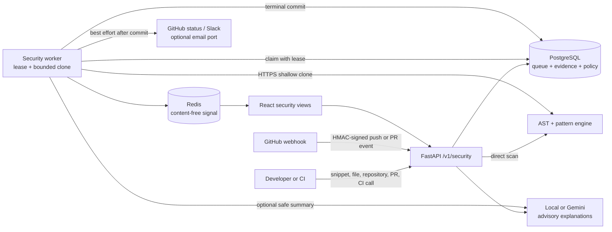

# Day 10: Secure Code Analysis

This guide explains the Day 10 secure-code-analysis bounded context: why it
exists, how it works, how to run it, and where its security boundaries are.
It is intentionally written in plain language. The scanner is useful because
it is predictable and bounded, not because it claims to replace a human
security review or a mature commercial SAST product.

## The problem in one example

Imagine a pull request contains this Python code:

```python
API_TOKEN = "a-real-production-token"
query = "SELECT * FROM users WHERE id = " + user_id
connection.execute(query)
```

There are two different jobs here:

1. **Detection:** identify a hardcoded secret and dynamic SQL every time the
   same code is scanned.
2. **Explanation:** help a developer understand why each finding matters and
   how to fix it.

The deterministic scanner performs the first job. Optional local or Gemini
explanations perform the second. An AI response can never lower a severity,
change a gate, or approve a scan.

## What is implemented

- Versioned Python AST and cross-language pattern rules.
- Stable finding fingerprints, deduplication, a bounded SHA-256-keyed cache,
  and redacted one-line evidence.
- Direct snippet and UTF-8 file scans.
- Asynchronous whole-repository and pull-request-diff scans.
- Signed GitHub push and pull-request webhook ingestion.
- Tenant-configurable block and review thresholds and resource limits.
- Durable scan queue, findings, settings, and one immutable human review per
  review-required scan.
- A leased worker with fencing, bounded retries, exponential backoff, and safe
  terminal errors.
- Optional advisory explanations, fix suggestions, reports, and summaries.
- Content-free Redis/WebSocket completion events for `agent` and `admin`
  users, followed by an authoritative REST refetch.
- Best-effort GitHub commit statuses and Slack notifications after a durable
  scan commit.
- A deployment-owned email protocol that can be injected by a future adapter.
- Four React views: Security Dashboard, Code Analysis, Repositories, and
  Security Settings.
- Unit, API, frontend, migration, PostgreSQL integration, worker, webhook,
  repository-boundary, and realtime tests.

The current output adapter creates a **GitHub commit status**. It does not post
a pull-request comment. Email is an injectable application port, but Compose
does not provide an SMTP or email adapter. Those distinctions matter when
planning production integrations.

### Feature matrix

| Capability | Delivered behavior | Authority |
|---|---|---|
| Detection | Six versioned AST/pattern rules with stable redacted findings | Deterministic engine |
| Gate | Tenant block/review thresholds and immutable admin review | Domain policy + PostgreSQL |
| Direct input | Synchronous snippet and UTF-8 file scans | FastAPI + engine |
| Git input | Queued whole-branch and base/head changed-file scans | Leased security worker |
| Automation | HMAC-signed GitHub push/PR webhooks and API-driven CI | FastAPI + durable queue |
| Explanation | Meaning, exploitation, fix guidance, report, optional summary | Advisory local/Gemini provider |
| User experience | Dashboard, Analysis, Repositories, Settings | React + REST/WebSocket |
| Output | GitHub commit status, Slack message, injectable email port | Best-effort adapters after commit |
| Audit | Tenant-scoped scans, findings, policy revisions, reviews | PostgreSQL |

## Architecture in plain language

Think of a security scan like an airport inspection:

- The **API** checks the passenger's identity and accepts an item for
  inspection.
- The **deterministic engine** is the X-ray machine. The same input and ruleset
  produce the same findings.
- The **security worker** handles larger baggage: repository and pull-request
  jobs are leased from PostgreSQL and scanned outside a database transaction.
- **PostgreSQL** is the official inspection record. Raw source is not stored.
- **Gemini or the local explanation provider** is an advisor who can explain
  the X-ray result but cannot change it.
- **Redis/WebSocket** is the display board announcing that a queued scan
  finished. The browser then fetches the official result from PostgreSQL.



## The six deterministic rules

Ruleset `day10.v1` contains these controls:

| Rule | Severity | Detector | CWE | OWASP 2021 mapping | Safer direction |
|---|---|---|---|---|---|
| Dynamic SQL execution | High | Python AST + pattern | CWE-89 | A03: Injection | Parameterized queries or prepared statements |
| Unsafe HTML assignment | Medium | Pattern | CWE-79 | A03: Injection | Safe DOM APIs plus context-aware encoding |
| Path traversal | High | Python AST + pattern | CWE-22 | A01: Broken Access Control | Resolve beneath an allowlisted root and reject traversal |
| Hardcoded secret | Critical | Python AST + pattern | CWE-798 | A07: Identification and Authentication Failures | Approved secret manager |
| Dynamic `eval` or `exec` | High | Python AST + pattern | CWE-95 | A03: Injection | Constrained parser or explicit dispatch |
| Command injection | High | Python AST + pattern | CWE-78 | A03: Injection | Argument lists, `shell=False`, and validated input |

AST analysis is used only for files whose path ends in `.py`. Pattern rules
also cover supported non-Python source. A pattern result is a warning backed
by a precise versioned rule, not proof that an exploit is possible. Human
review and normal tests remain necessary.

The repository scanner considers these suffixes:

```text
.c .cc .cpp .go .java .js .jsx .php .py .rb .ts .tsx
```

It skips build output, virtual environments, caches, `node_modules`, `vendor`,
`.git`, symlinks, binary/non-UTF-8 data, oversized files, and paths outside the
temporary clone root. It never imports, compiles, or executes repository code.

## How a finding is produced

1. Validate that source text, relative path, and byte size are bounded.
2. Parse Python safely with `ast.parse` when the file is Python.
3. Run enabled regex patterns line by line.
4. Convert matches into immutable candidates.
5. Deduplicate overlaps, such as an AST and pattern detector finding the same
   issue.
6. Redact credential-like values before persistence or display.
7. Build a stable SHA-256 fingerprint from trusted rule and location data.
8. Count findings by severity and apply the tenant's deterministic gate.

The cache key includes the ruleset version, file path, and source content. It
uses SHA-256 and a fixed maximum entry count, so two files with equal content
do not accidentally share the wrong location and memory cannot grow forever.

## Gates and human review

The default tenant policy is:

| Highest finding | Gate result |
|---|---|
| Critical | `block` |
| High | `review_required` |
| Medium, low, info, or no finding | `approve` |

An administrator can move the block and review thresholds, but the block
threshold must remain stronger than the review threshold. For example, a
tenant may block both critical and high findings by setting block to `high`
and review to `medium`.

A `review_required` scan may receive one immutable admin decision:
`approved` or `blocked`, with an optional safe audit note. The review does not
rewrite the original deterministic gate; it adds a separate auditable human
decision. Scan detail returns that review after a reload, so the browser shows
the recorded evidence instead of offering a duplicate decision. For a GitHub
repository scan, the final review also replaces the pending commit status with
`success` or `failure`; a status-delivery failure cannot roll back the review.

## Scan entry points

### API coverage

All routes except the signed webhook require a verified bearer token. “Read”
means either `agent` or `admin`; “manage” means `admin` only.

| Method and path | Access | Purpose |
|---|---|---|
| `GET /v1/security/rules` | Read | Version and enabled deterministic rules |
| `POST /v1/security/scans/snippet` | Read | Synchronous pasted-code scan |
| `POST /v1/security/scans/file` | Read | Synchronous multipart UTF-8 file scan |
| `GET /v1/security/scans` | Read | Recent tenant scans |
| `GET /v1/security/scans/{scan_id}` | Read | One scan with findings |
| `POST /v1/security/findings/{finding_id}/explanation` | Read | Advisory explanation |
| `POST /v1/security/findings/{finding_id}/fix` | Read | Advisory secure alternative |
| `POST /v1/security/scans/{scan_id}/report` | Read | Advisory scan report |
| `GET /v1/security/repositories` | Read | Tenant repository catalog |
| `POST /v1/security/repositories` | Manage | Register an allowlisted repository |
| `POST /v1/security/repositories/{repository_id}/scans` | Read | Queue a branch scan |
| `POST /v1/security/repositories/{repository_id}/pull-request-scans` | Read | Queue a base/head diff scan |
| `GET /v1/security/settings` | Read | Current revisioned tenant policy |
| `PUT /v1/security/settings` | Manage | Update policy with expected revision |
| `POST /v1/security/scans/{scan_id}/reviews` | Manage | Record one review-required decision |
| `GET /v1/security/dashboard` | Read | Counts, trend, top rules, and recent scans |
| `POST /v1/security/webhooks/github/{tenant_id}/{repository_id}` | HMAC | Queue enabled push or PR automation |

### One-command local demo

With the local stack running, exercise login, the gateway, the authenticated
snippet endpoint, deterministic rules, persistence, and the gate in one step:

```bash
./scripts/demo-code-security.sh
```

The script never prints the bearer token or raw secret evidence. It is a local
learning smoke test, not a production authentication or benchmarking tool.

### Snippet and file scans

`POST /v1/security/scans/snippet` and `POST /v1/security/scans/file` run
synchronously. The API validates the request, runs the deterministic engine,
commits the redacted result, and returns `201` with the gate and findings.

Only UTF-8 file uploads are accepted. The filename must be a simple relative
name, and both global and tenant byte limits apply.

### Whole-repository scans

`POST /v1/security/repositories/{repository_id}/scans` returns `202`. The scan
is queued in PostgreSQL. The security worker later claims it, shallow-clones
the selected branch, scans supported files, commits the result, and emits a
content-free completion signal.

### Pull-request scans

`POST /v1/security/repositories/{repository_id}/pull-request-scans` also
returns `202`. The worker fetches bounded head/base history, deepens up to 1,024
commits until it proves a merge base, asks Git for
added/copied/modified/renamed paths since that merge base, and scans only those
changed files. If the merge base is outside that safety budget, the scan fails
closed. It is a Git ref/commit diff, not a GitHub PR API lookup.

### GitHub webhooks

GitHub calls:

```text
POST /v1/security/webhooks/github/{tenant_id}/{repository_id}
```

The endpoint:

1. requires `X-Hub-Signature-256=sha256=...` and verifies it with constant-time
   HMAC comparison using a tenant-and-repository-derived key;
2. accepts only a bounded JSON body;
3. parses push events and opened, reopened, or synchronized pull requests;
4. validates human-readable refs but queues immutable commit SHAs from the
   signed payload;
5. checks that the event's normalized repository URL exactly matches the
   registered tenant repository;
6. applies the tenant's automatic push/PR flags; and
7. accepts only same-repository pull requests (fork PRs fail closed until a
   separately authorized fetch design exists); and
8. uses `X-GitHub-Delivery` as a durable duplicate-delivery boundary.

Unsupported events are acknowledged but ignored. A missing webhook secret
causes the route to fail closed as not found.

### CI usage

CI uses the same authenticated API; there is no separate public “CI scan”
route. A pipeline can upload one generated/source file, submit a snippet, or
queue the registered repository/branch or PR diff. It then reads
`gate_decision` and fails the job for `block`, while routing
`review_required` through the organization's approval process.

The domain reserves a `ci` source type for transport adapters that may be
added later. Do not claim a dedicated CI endpoint exists today.

## Safe repository ingestion

Repository scanning deliberately rejects flexible Git syntax because Git URLs
and refs are command inputs.

- HTTPS only; no SSH, local paths, `file://`, credentials, query, or fragment.
- Exact DNS-host allowlist; subdomain suffix tricks do not pass.
- No custom port and no percent-encoded path tricks.
- Exactly one owner and repository path.
- Conservative refs that reject option-like values, `..`, `//`, `@{`, and
  other refspec tricks.
- `--` before the remote URL and destination.
- `GIT_TERMINAL_PROMPT=0`, `GIT_ASKPASS=/bin/false`, no system Git config, no
  LFS smudge, no tags, shallow history, and bounded command time.
- A fresh temporary directory for every scan.
- Symlink rejection and resolved-path containment.
- Per-file, file-count, repository-byte, finding-count, clone-time, and
  scan-time ceilings.

The current adapter is intended for public allowlisted HTTPS repositories.
The GitHub API token is used for commit-status output; it is not injected into
clone URLs for private-repository access.

## AI is advisory and receives redacted evidence

`CHAT_CODE_SECURITY_AI_MODE` has three values:

| Mode | Behavior |
|---|---|
| `disabled` | Explanation, fix, and report endpoints return `503` |
| `echo` | Local deterministic teaching explanations; no external request |
| `gemini` | Gemini REST adapter with structured output and bounded timeout |

The AI boundary receives the rule, severity, safe message, path, line,
redacted one-line evidence, recommendation, CWE, and OWASP category. It does
not receive raw repository source or detected secret values. Untrusted
evidence is separated from instructions. Request-time provider errors become
safe `503` responses. A worker-summary provider error only omits the advisory
summary; the deterministic findings and gate still commit successfully. Raw
provider responses are not persisted.

AI may produce:

- what a finding means;
- how it could be exploited;
- remediation steps and a secure example;
- a suggested fix to review, test, and re-scan; and
- a scan report or an optional bounded one-line worker summary.

It cannot create findings, alter severity, change a gate, or record a human
review.

## Durable data model

All rows are tenant scoped, and relationships include tenant identifiers.

| Table | Purpose |
|---|---|
| `code_repositories` | Registered normalized HTTPS repository and default branch |
| `code_scans` | Queue state, lease/fencing data, source metadata, counts, gate, and terminal result |
| `code_security_findings` | Immutable deduplicated redacted evidence and remediation metadata |
| `code_security_settings` | Revisioned tenant thresholds, limits, webhook flags, and AI-summary flag |
| `code_scan_reviews` | One immutable admin decision for a review-required scan |

The database rejects invalid lifecycle combinations, counts, severities,
paths, refs, hashes, URLs, timestamps, and tenant-crossing foreign keys.
`PUBLIC` receives no table privileges. Runtime roles cannot update or delete
finding or review evidence.

Raw source is not persisted. A direct scan stores a content hash and redacted
finding lines. A repository scan additionally stores the commit SHA and safe
summary counts.

## Worker reliability

The security worker follows a short-transaction pattern:

1. Claim one eligible row with a lease token and expiry.
2. Commit the claim.
3. Persist content-free `validating`, `detecting`, and `gating` progress under
   the same lease while cloning and analysis happen outside a transaction.
4. Commit only if the same lease token still owns the row.
5. Publish realtime and external notifications only after the durable commit.

Transient repository or adapter failures are rescheduled with bounded
exponential backoff. After the configured attempt limit, the scan becomes
failed with a generic safe message. An expired lease may be reclaimed by
another worker. A stale worker cannot overwrite the new owner because terminal
updates are fenced by the lease token.

Realtime and external notifications are best effort. If Redis, GitHub, or
Slack is down after the database commit, the scan remains correct and can be
read through REST, but this implementation does not durably retry those
security-result notifications.

## Realtime contract

Repository, PR, and webhook scans publish `code_scan.status.v1` after success
or terminal failure. The payload contains only:

- scan ID;
- status;
- gate decision, when available;
- total finding count; and
- occurrence time.

Redis uses a tenant channel. The API forwards scan events only to authenticated
connections in that tenant whose roles include `agent` or `admin`. The browser
does not trust the event as a result; it refetches the scan/dashboard through
REST.

## Roles and the four screens

| Role | Access |
|---|---|
| `user` | No code-security routes or screens |
| `agent` | Read dashboard, rules, scans, findings, repositories, and settings; run/queue scans; request advisory AI help |
| `admin` | Everything an agent can do, plus register repositories, change settings, and record reviews |

The React application provides:

1. **Security Dashboard** — severity counts, scan trend, top vulnerabilities,
   recent scans, and realtime refresh.
2. **Code Analysis** — paste a snippet or upload a file; inspect severity,
   CWE/OWASP mapping, redacted evidence, recommendations, explanations, fix
   suggestions, reports, and review-required scans.
3. **Repositories** — register an allowlisted repository, queue a branch scan,
   queue a base/head diff, see status/gate badges, and refresh on completion.
4. **Security Settings** — view tenant limits and thresholds; admins update
   them with an expected revision so concurrent edits return `409` instead of
   silently overwriting each other.

## Local configuration

The safe learning defaults are already in `.env.example`:

```dotenv
CHAT_CODE_SECURITY_ENABLED=true
CHAT_CODE_SECURITY_AI_MODE=echo
CHAT_CODE_SECURITY_WEBHOOK_SECRET=
CHAT_CODE_SECURITY_ALLOWED_GIT_HOSTS=github.com
CHAT_CODE_SECURITY_CLONE_TIMEOUT_SECONDS=30
CHAT_CODE_SECURITY_SCAN_TIMEOUT_SECONDS=120
CHAT_CODE_SECURITY_WORKER_POLL_INTERVAL_SECONDS=0.5
CHAT_CODE_SECURITY_WORKER_LEASE_SECONDS=900
CHAT_CODE_SECURITY_WORKER_MAX_ATTEMPTS=3
CHAT_CODE_SECURITY_WORKER_INITIAL_BACKOFF_SECONDS=2
CHAT_CODE_SECURITY_WORKER_MAX_BACKOFF_SECONDS=60
CHAT_CODE_SECURITY_MAX_FILE_SIZE_BYTES=10485760
CHAT_CODE_SECURITY_MAX_REPOSITORY_FILES=2000
CHAT_CODE_SECURITY_MAX_REPOSITORY_BYTES=52428800
CHAT_CODE_SECURITY_MAX_FINDINGS_PER_SCAN=10000
CHAT_CODE_SECURITY_GITHUB_TOKEN=
CHAT_CODE_SECURITY_GITHUB_API_BASE_URL=https://api.github.com
CHAT_CODE_SECURITY_SLACK_WEBHOOK_URL=
```

For webhook testing, generate a secret without printing it into shell history:

```bash
uv run python -c 'import secrets; print(secrets.token_urlsafe(48))'
```

Place the result in `.env` as `CHAT_CODE_SECURITY_WEBHOOK_SECRET`. This is a
server-only master key, not the value configured directly in GitHub. Each
repository webhook uses a derived key so compromise of one hook cannot sign a
request for another tenant or repository. Keep `.env` out of source control.

For Gemini explanations, set:

```dotenv
CHAT_CODE_SECURITY_AI_MODE=gemini
CHAT_GEMINI_API_KEY=replace-locally
CHAT_GEMINI_MODEL=gemini-2.5-flash
```

The chat provider and security explanation mode are independent. You may use
Echo for chat and Gemini for security explanations.

## Run locally

From the repository root:

```bash
./scripts/start-local.sh
docker compose ps --all
docker compose logs --follow --tail=100 api security-worker
```

The expected `security-worker` state is running. Open
<http://localhost:3000>, sign in as **Support Agent** or **Administrator**, and
use the Security section. If `APP_PORT` is different, use that port instead.

Try this progression:

1. Scan `print("hello")`; expect `approve` with no findings.
2. Scan `eval(user_input)` as `example.py`; expect a high finding and
   `review_required` under the default policy.
3. Scan `API_TOKEN = "this-is-a-real-secret"`; expect a critical finding and
   `block`.
4. As an admin, register a public GitHub repository and queue its default
   branch.
5. Watch the repository screen update after the content-free WebSocket event.

## API examples

The gateway exposes API routes under `/api`. Obtain a short-lived local admin
token from the explicitly enabled demo login:

```bash
API_ORIGIN=http://localhost:3000
LOGIN_RESPONSE="$(curl --fail-with-body --silent --show-error \
  -H 'Content-Type: application/json' \
  -d '{"tenant_id":"tenant_1","role":"admin"}' \
  "$API_ORIGIN/api/auth/login")"
TOKEN="$(printf '%s' "$LOGIN_RESPONSE" | \
  uv run python -c 'import json,sys; print(json.load(sys.stdin)["access_token"])')"
```

List the authoritative rule set:

```bash
curl --fail-with-body --silent --show-error \
  -H "Authorization: Bearer $TOKEN" \
  "$API_ORIGIN/api/v1/security/rules"
```

Scan a Python snippet:

```bash
curl --fail-with-body --silent --show-error \
  -H "Authorization: Bearer $TOKEN" \
  -H 'Content-Type: application/json' \
  -d '{"source_label":"demo.py","code":"eval(user_input)"}' \
  "$API_ORIGIN/api/v1/security/scans/snippet"
```

Scan a local UTF-8 file:

```bash
curl --fail-with-body --silent --show-error \
  -H "Authorization: Bearer $TOKEN" \
  -F 'file=@demo.py' \
  "$API_ORIGIN/api/v1/security/scans/file"
```

Register and queue an allowlisted public repository:

```bash
REPOSITORY_RESPONSE="$(curl --fail-with-body --silent --show-error \
  -H "Authorization: Bearer $TOKEN" \
  -H 'Content-Type: application/json' \
  -d '{"display_name":"Hello World","clone_url":"https://github.com/octocat/Hello-World.git","default_branch":"master"}' \
  "$API_ORIGIN/api/v1/security/repositories")"
REPOSITORY_ID="$(printf '%s' "$REPOSITORY_RESPONSE" | \
  uv run python -c 'import json,sys; print(json.load(sys.stdin)["id"])')"

curl --fail-with-body --silent --show-error \
  -H "Authorization: Bearer $TOKEN" \
  -H 'Content-Type: application/json' \
  -d '{"branch":"master"}' \
  "$API_ORIGIN/api/v1/security/repositories/$REPOSITORY_ID/scans"
```

Queue a pull-request-style diff when both refs exist in the registered
repository:

```bash
curl --fail-with-body --silent --show-error \
  -H "Authorization: Bearer $TOKEN" \
  -H 'Content-Type: application/json' \
  -d '{"base_branch":"main","head_branch":"feature/security-fix"}' \
  "$API_ORIGIN/api/v1/security/repositories/$REPOSITORY_ID/pull-request-scans"
```

For CI, capture the response and enforce the deterministic gate. This example
uses the snippet route; the repository routes work the same way but return a
queued scan that CI must poll through `GET /v1/security/scans/{scan_id}`:

```bash
SCAN_RESPONSE="$(curl --fail-with-body --silent --show-error \
  -H "Authorization: Bearer $TOKEN" \
  -H 'Content-Type: application/json' \
  -d '{"source_label":"ci-check.py","code":"eval(user_input)"}' \
  "$API_ORIGIN/api/v1/security/scans/snippet")"
GATE="$(printf '%s' "$SCAN_RESPONSE" | \
  uv run python -c 'import json,sys; print(json.load(sys.stdin)["gate_decision"])')"
test "$GATE" = approve
```

For a GitHub webhook, first derive the repository-bound key and configure that
derived value as the GitHub webhook secret. GitHub then generates signatures.
A local smoke test can calculate the same HMAC over the exact bytes sent:

```bash
export MASTER_WEBHOOK_SECRET='replace-with-the-value-from-.env'
export TENANT_ID='TENANT_UUID'
export REPOSITORY_ID='REPOSITORY_UUID'
export WEBHOOK_SECRET="$(uv run python -c 'import os; from uuid import UUID; from enterprise_chat_platform.infrastructure.code_analysis.github_webhook import derive_repository_webhook_secret; print(derive_repository_webhook_secret(master_secret=os.environ["MASTER_WEBHOOK_SECRET"], tenant_id=UUID(os.environ["TENANT_ID"]), repository_id=UUID(os.environ["REPOSITORY_ID"])))')"
export WEBHOOK_BODY='{"ref":"refs/heads/main","after":"aaaaaaaaaaaaaaaaaaaaaaaaaaaaaaaaaaaaaaaa","repository":{"clone_url":"https://github.com/OWNER/REPOSITORY.git"}}'
SIGNATURE="$(printf '%s' "$WEBHOOK_BODY" | WEBHOOK_SECRET="$WEBHOOK_SECRET" \
  uv run python -c 'import hashlib,hmac,os,sys; print("sha256=" + hmac.new(os.environ["WEBHOOK_SECRET"].encode(), sys.stdin.buffer.read(), hashlib.sha256).hexdigest())')"

curl --fail-with-body --silent --show-error \
  -H "X-Hub-Signature-256: $SIGNATURE" \
  -H 'X-GitHub-Event: push' \
  -H 'X-GitHub-Delivery: local-smoke-001' \
  -H 'Content-Type: application/json' \
  --data-binary "$WEBHOOK_BODY" \
  "$API_ORIGIN/api/v1/security/webhooks/github/TENANT_UUID/REPOSITORY_UUID"
```

The repository URL in the payload must exactly match the registered normalized
URL, and the path requires UUIDs rather than demo aliases.

## External outputs

Set `CHAT_CODE_SECURITY_GITHUB_TOKEN` to enable GitHub commit-status output for
GitHub repositories. The worker maps gates as follows:

| Gate | GitHub state |
|---|---|
| `approve` | `success` |
| `review_required` | `pending` |
| `block` | `failure` |

An immutable admin review changes the same context from `pending` to
`success` for `approved` or `failure` for `blocked`.

The context is `enterprise/security-gate`. This is a commit status, **not a PR
comment or GitHub Check Run**.

Set `CHAT_CODE_SECURITY_SLACK_WEBHOOK_URL` to an official
`https://hooks.slack.com/...` URL for a short result notification. Message
content contains repository name, abbreviated commit SHA, gate, and count—not
source or finding snippets.

`SecurityEmailSender` defines an email integration contract, but no email
adapter is composed by the application. A production deployment can implement
and inject it. Email is therefore an extension point, not a currently delivered
message channel.

These are deliberate differences from the tutorial prototype: deployment
secrets remain server-side instead of being entered in browser settings;
commit statuses provide a machine-enforceable branch gate instead of a PR
comment; and deterministic rules—not AI-generated risk scores—own severity and
approval. The reference's email switch also has no delivery adapter, so this
project exposes an explicit typed port rather than pretending a message was
sent.

## Tests

Run the isolated backend suite:

```bash
uv lock --check
uv sync --frozen --all-groups
uv run ruff format --check src tests migrations
uv run ruff check src tests migrations
uv run mypy src tests migrations/env.py migrations/versions
uv run pytest -q
```

Run frontend tests and the release build:

```bash
npm --prefix frontend ci
CI=true npm --prefix frontend test -- --watchAll=false --runInBand
CI=true npm --prefix frontend run build
```

Run the real PostgreSQL suite only against the disposable local database using
the integration procedure in the main README. Stop `api`, `worker`,
`security-worker`, and `relay` while schema-changing tests run.

Focused Day 10 checks include:

```bash
uv run pytest tests/unit/domain/test_code_security.py -q
uv run pytest tests/unit/infrastructure/code_analysis -q
uv run pytest tests/unit/api/test_code_security_api.py -q
uv run pytest tests/unit/test_code_security_worker.py -q
uv run pytest -m integration tests/integration/test_code_security_schema_integration.py -q
uv run pytest -m integration tests/integration/test_code_security_store_integration.py -q
```

## Performance targets

These are engineering targets from the lesson, not guarantees proven for every
machine or repository:

| Operation | Target |
|---|---|
| Snippet scan | under 2 seconds |
| Repository scan | under 30 seconds for a representative bounded repository |
| Security dashboard | under 1 second |
| Direct concurrency | at least 5 simultaneous snippet requests |

The default hard timeouts are 30 seconds for an individual Git operation and
120 seconds for repository analysis. Repository latency naturally depends on
network, history, file count, and source size. Before production, load-test
with representative repositories and record p50/p95/p99 latency, throughput,
queue age, memory, cache hit rate, finding volume, and provider latency.

## Threat model

| Threat | Control |
|---|---|
| Cross-tenant read or write | Verified JWT tenant, role checks, composite tenant keys and foreign keys |
| SSRF or local-file clone | HTTPS-only exact host allowlist; no credentials, custom ports, query, fragment, or alternate schemes |
| Git option/ref injection | Conservative ref grammar, argument arrays, and `--` separators |
| Malicious repository filesystem | Fresh temp root, symlink rejection, resolved-path containment, suffix allowlist |
| Resource exhaustion | File/count/byte/finding/time ceilings, shallow clone, bounded cache, queued worker |
| Source execution | Parser and text matching only; no imports, builds, hooks, or tests |
| Secret persistence or AI leakage | One-line redaction; raw source is not stored or sent to the explanation provider |
| Webhook forgery/replay | HMAC-SHA256, constant-time comparison, bounded payload, delivery ID uniqueness, URL match |
| AI changes policy | Deterministic findings and gate are authoritative; AI response is advisory only |
| Stale worker overwrites a scan | Lease token fencing and expiry |
| Browser trusts Pub/Sub | Content-free event followed by authenticated REST refetch |
| Concurrent settings edits | Expected revision and `409 Conflict` |

Residual risks remain. Regex rules have false positives and false negatives;
AST rules cover Python only; allowlisted public hosts can still contain hostile
content; clone bandwidth is consumed before all source limits are known;
outbound notification failures are not durable; and a compromised runtime or
database role changes the threat model. Layer this scanner with dependency,
secret, container, IaC, and dynamic testing plus human review.

## Failure modes

| Failure | Behavior | Operator action |
|---|---|---|
| Invalid snippet/file | Request fails with a generic `422` or size-specific `413` | Fix encoding, path, or limit |
| Clone/ref/repository problem | Worker retries, then stores a safe failed result | Inspect safe logs and repository/ref configuration |
| Security worker stops | Queued rows remain durable; expired leases can be reclaimed | Restart or scale `security-worker` |
| Worker loses its lease | Stale completion is rejected | Let the current lease owner finish |
| Gemini unavailable | Gate remains deterministic; explanation endpoint returns `503`; queued scans commit without an optional AI summary | Use `echo`, restore the provider, or request an explanation later |
| Redis/WebSocket unavailable | Scan remains durable; browser can poll REST | Restore Redis/API subscriber |
| GitHub/Slack output fails | Durable scan remains successful, but notification may be missed | Inspect logs and retry externally; consider an outbox adapter |
| Duplicate GitHub delivery | Existing delivery boundary prevents duplicate queued work | No action unless payloads differ unexpectedly |
| Settings race | Later writer receives `409` | Refetch revision and apply the intended change |
| PostgreSQL unavailable | Readiness fails and no false durable success is returned | Restore database before accepting work |

## Production checklist

- Keep the repository allowlist narrow and use outbound network controls in
  addition to application validation.
- Run clones in a sandboxed, resource-limited worker environment with a
  read-only root filesystem and disposable temporary storage.
- Decide how private repositories will use short-lived credentials without
  placing them in URLs or logs; the current clone adapter does not solve this.
- Store webhook, GitHub, Slack, Gemini, database, Redis, and JWT secrets in a
  secret manager and rotate them.
- Use TLS for every external boundary and authenticated/TLS Redis.
- Protect GitHub branches with the `enterprise/security-gate` commit status if
  it is part of merge policy.
- Add durable notification delivery if GitHub/Slack/email is a compliance
  requirement rather than a convenience.
- Treat AI fixes as untrusted code: review, test, scan, and approve them.
- Baseline false-positive and false-negative rates; version every rule change
  and preserve old scan evidence.
- Monitor queue age, active/expired leases, retries, failures, scan duration,
  bytes/files scanned, findings by severity/rule, webhook rejects, provider
  latency, and notification failures.
- Test webhook secret rotation and replay behavior.
- Benchmark the performance targets with representative repositories and peak
  concurrent traffic.
- Add SCA, secret scanning, IaC/container scanning, and DAST rather than
  presenting six teaching rules as complete coverage.
- Keep migration approval, PostgreSQL backups/PITR, restore drills, incident
  ownership, and audit-retention policy documented.

The central design lesson is simple: **deterministic code decides; AI
explains; PostgreSQL remembers; humans own exceptions.**
